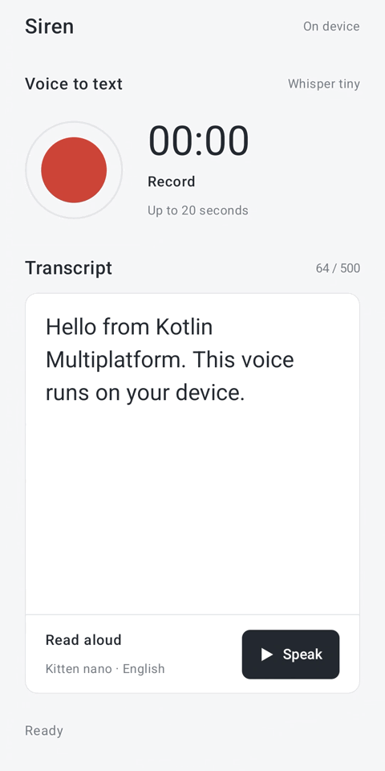

# Siren — speech for Kotlin Multiplatform

Run **speech-to-text and text-to-speech on device** in Android, iOS and JVM apps. Siren handles compatible Whisper/Kitten model configuration, native inference and cleanup. Your app supplies the model files and audio input/output.

The SDK has **no UI, Compose dependency, bundled weights or hidden downloads**.

[](https://github.com/Debanshu777/Siren/actions/workflows/check.yml)
[](https://central.sonatype.com/artifact/io.github.debanshu777/siren/0.1.0)
[](LICENSE)

[Get started](#get-started) · [Configuration](docs/model-configuration.md) · [Samples](#sample-apps) · [Verification](docs/development.md)



*Actual Android sample. [Capture provenance and limits](docs/demo.md).*

## Get started

Siren **0.1.0** is available on [Maven Central](https://central.sonatype.com/artifact/io.github.debanshu777/siren/0.1.0). [Release notes](https://github.com/Debanshu777/Siren/releases/tag/v0.1.0).

### 1. Add the dependency

With `mavenCentral()` configured, add to your KMP shared module:

```kotlin
commonMain.dependencies {
    implementation("io.github.debanshu777:siren:0.1.0")
}
```

### 2. Put the model bundle in your app

For automatic build-time packaging, the [optional Gradle model helper](docs/optional-models.md) is available from source. It is a local, unpublished add-on; the published SDK dependency alone still requires app-owned model files.

Use the [standard bundle](docs/getting-started.md#place-the-model-bundle): Whisper tiny INT8 and Kitten nano INT8 files under `models/whisper/` and `models/kitten/`. Android reads assets, iOS reads application resources, and JVM reads classpath resources. Siren already knows the seven filenames; you do not map them individually.

The SDK does not include or download these weights. For an existing local bundle, use the [one-line local-directory override](docs/model-configuration.md#change-the-directory-or-capability).

### 3. Create an engine and call it

From a coroutine in `androidMain`, pass your app's mono recording and its actual sample rate:

```kotlin
import io.github.debanshu.siren.speech.createSpeechEngine
import io.github.debanshu.siren.speech.transcribe
import io.github.debanshu.siren.speech.use

val replyAudio = createSpeechEngine(context).use { engine ->
    val text = engine.transcribe(recording.samples, recording.sampleRate)
    engine.synthesize(text)
}
```

On iOS or desktop, use `createSpeechEngine()` instead; the block stays the same. For text-to-speech alone, call `engine.synthesize("Hello from Siren.")` inside the scope.

`use` closes the engine automatically, including after failure or cancellation. The returned `PcmAudio` holds independent mono float samples and their playback rate. Your app records the input and plays `replyAudio.samples` at `replyAudio.sampleRate`.

See [the complete quickstart](docs/getting-started.md) for resource placement and longer-lived engines. Custom filenames, optional capabilities and other model providers are covered in [advanced configuration](docs/model-configuration.md).

## Platform support

| Target | Runtime packaging | Observed verification |
| --- | --- | --- |
| Android API 27+ | arm64-v8a, x86_64 JNI | Pixel 9 native/physical audio/UI checks; x86_64 packaged, not device-tested |
| iOS | arm64 device/simulator static archives in KLIBs | Both dynamic consumer links; simulator app/native check. Physical iPhone audio unverified |
| JVM macOS arm64 | Native resources in JVM JAR | Native/relocated inference; packaged sample built and visually checked |
| JVM Linux x64 | Native resources in JVM JAR | Native model roundtrip passed in CI |
| JVM macOS x64, Linux arm64, Windows arm64/x64 | Native resources in JVM JAR | Packaged/hash-verified; execution untested |

The reference build uses Kotlin 2.4.21 and Java 17 bytecode; contributors use JDK 21. The pinned Compose sample uses iOS 18.5+. Wasm is unsupported. [Evidence and limits](docs/development.md).

## Sample apps

The separate [`sample/`](sample/README.md) adds a shared Compose screen, controller, microphone/playback adapters and model preparation:

```bash
./gradlew :sample:androidApp:assembleDebug
open sample/iosApp/iosApp.xcodeproj
./gradlew :sample:desktopApp:run
```

See [Android](sample/androidApp/README.md), [iOS](sample/iosApp/README.md) and [desktop](sample/desktopApp/README.md) setup. Desktop packaging needs a full JDK accepted by Compose/jpackage. SDK runtime preparation contains no weights; default sample builds prepare both bundles. Disabling a capability at runtime does not trim already packaged files.

## Scope

- Built-in Whisper adapters accept 0.2–20-second clips; the sample also limits TTS input to 500 characters.
- Scoped `use` handles cleanup. Long-lived engines have one lifecycle owner and must be closed when that owner finishes.
- Cancellation discards obsolete results but waits for synchronous native decoding before destruction.
- Custom descriptors/SPI remain available. Arbitrary ONNX graphs need compatible adapters.
- The sample is foreground-only; streaming, VAD, production model installation and automatic route recovery are outside it. Desktop hardware audio remains unverified.

## Documentation

[Getting started](docs/getting-started.md) · [Model configuration](docs/model-configuration.md) · [SDK](siren/README.md) · [Architecture](docs/architecture.md) · [Integration tutorial](docs/medium-draft.md) · [Development](docs/development.md) · [Release verification](docs/releasing.md)

## Recent Changes

Prepared an optional Gradle add-on that verifies and packages selected models during app builds. The add-on remains unpublished; Siren 0.1.0 and its core runtime are unchanged.

Published [Siren 0.1.0](https://github.com/Debanshu777/Siren/releases/tag/v0.1.0) to Maven Central with signed Android, iOS and JVM artifacts. The [release pipeline](https://github.com/Debanshu777/Siren/actions/runs/45062849601) verified public delivery and a separate Central-only consumer. The quickstart uses one scoped engine for transcription and synthesis.

## License

First-party source is [MIT](LICENSE). Native components and model assets retain their own licenses; preserve [third-party notices and audit status](THIRD_PARTY_NOTICES.md).
