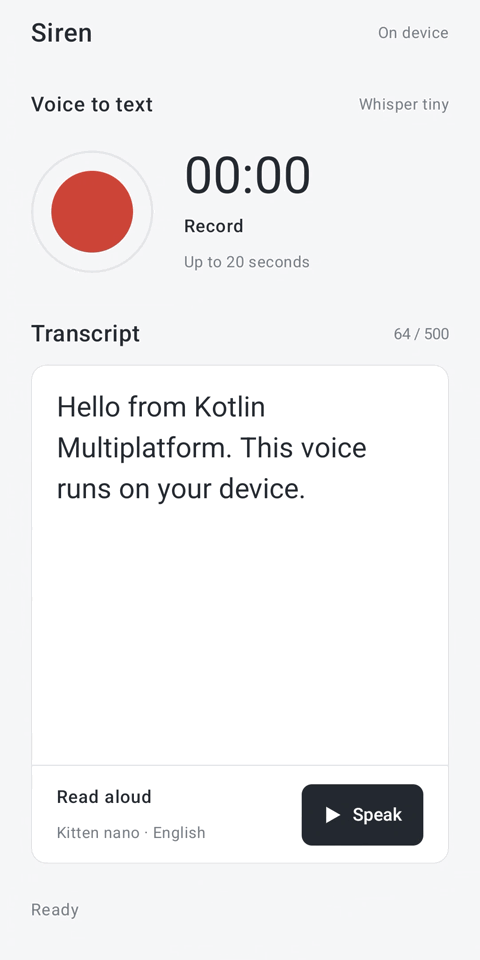
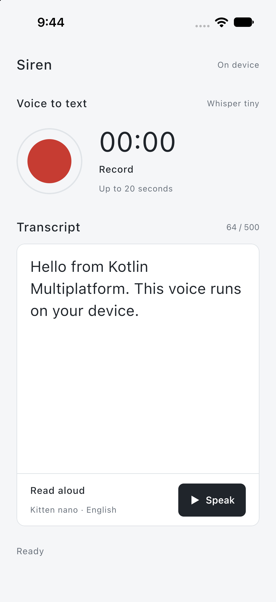
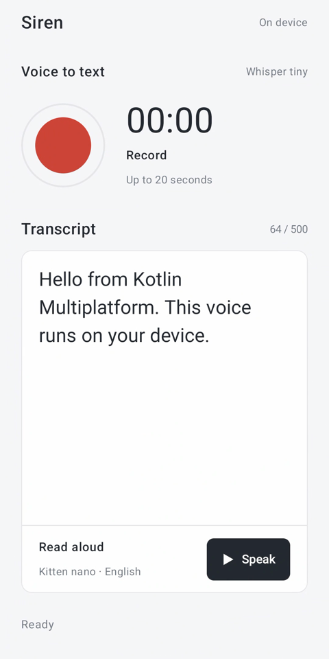
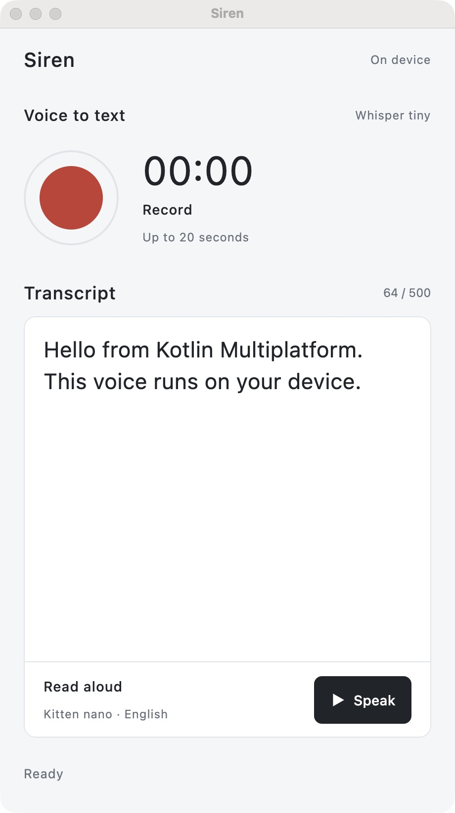

# Demo and captures

Record up to 20 seconds, stop and transcribe, edit the transcript, then Speak. The playback button becomes Stop while generating or playing speech. Cancel discards recording or transcription; synchronous native work may finish before cleanup.

For the code behind these interactions, see [the tutorial's minimal Compose screen](medium-draft.md#8-add-a-small-compose-screen). It connects the same controller actions without the finished app's visual styling.



This GIF records the real Android UI. For a repeatable capture, a test fixture synthesizes a fixed sentence and plays it through the phone's speaker while the normal controller records the microphone. It then presses the real Stop & transcribe and Speak controls. The fixture never inserts a transcript or changes the UI phase directly. GIFs are silent; the physical audio-path evidence is recorded separately.

## Screenshots





Capture environment: Pixel 9 / Android 17 and iPhone 17 arm64 simulator / iOS 27, 2026-11-22. Android media is cropped to the actual application area, excluding the system status bar, developer refresh-rate overlay and gesture bar. No application controls or results are painted over. The iOS screenshot is a complete simulator capture. Screenshots establish appearance; the [verification notes](development.md) distinguish native, acoustic and UI journey checks.

These captures show the extracted Siren sample. Configured model labels and available controls come from the selected providers; see [model configuration](model-configuration.md). The earlier `speech-demo.gif`, `ios-simulator.png` and `android-pixel9.png` remain historical captures for the 2026-11-21 evidence.



The macOS arm64 package built and launched on 2026-11-22. Both its classpath-model and packaged-JAR model-only checks passed; the screenshot verifies the actual screen. Desktop microphone and audible playback have not been checked. See [desktop evidence](../sample/desktopApp/verification/macos-arm64-2026-11-22.json).

## Selected design direction

- **Product:** short recordings become editable text and local spoken audio.
- **Character:** direct, quiet, tactile.
- **World:** a pocket voice recorder and its transcript.
- **Moments:** the circular record/stop control and the transcript workspace.
- **Signature:** an elapsed-time ring around the recording control, tied to the actual 20-second limit.

The title stays compact. Recording comes first, the transcript receives the main workspace, and playback stays attached to the text. One red recording accent sits within a neutral light palette. Typography uses the native sans-serif family and regular/medium weights. Spacing follows a 4 dp rhythm. The input and controls scroll on short screens or at larger font scales, and status/errors use accessibility live regions. No decorative waveform or invented microphone levels are shown.

This design pass follows [Unslop](https://github.com/heydamir/unslop/blob/main/skills/unslop/SKILL.md), created by Damir Sokolovsky, licensed [CC BY 4.0](https://creativecommons.org/licenses/by/4.0/). The app retains its name, recording → transcript → playback order, and native implementation.

## Reproduce the UI journey

Use an unlocked phone, an audible media volume, and the built-in speaker/microphone. Install the APKs with Gradle, grant microphone access before starting the fixture, then run the opt-in test:

```bash
ANDROID_SERIAL=YOUR_SERIAL ./gradlew :sample:androidApp:installDebug :sample:androidApp:installDebugAndroidTest
adb -s YOUR_SERIAL shell pm grant dev.debanshu.speech.sample android.permission.RECORD_AUDIO
adb -s YOUR_SERIAL shell am instrument -w -r -e demo true \
  -e class io.github.debanshu.siren.sample.android.SpeechUiDemoTest \
  dev.debanshu.speech.sample.test/androidx.test.runner.AndroidJUnitRunner
```

The fixture uses live Compose semantics callbacks rather than Espresso or an accessibility automation service. It requires permission and audible volume in advance and leaves the volume unchanged. The regular connected suite removes the installed sample afterward, so the separate install step matters for this capture recipe.

The 2026-11-22 run passed in 16.947 seconds and recognized “The quick brown fox jumps over the lazy dog.” (44 characters, all six content words). See the [recorded result](../sample/androidApp/verification/siren-sdk-ui-2026-11-22.json). Capture with Android’s `screenrecord` and export the interval from the visible Ready screen through final Ready. The shipped Siren GIF uses 480 × 960 pixels, 8 fps, a 14.5-second actual interval and a repeating loop. Status bars and the developer overlay are cropped; app content is not altered.
