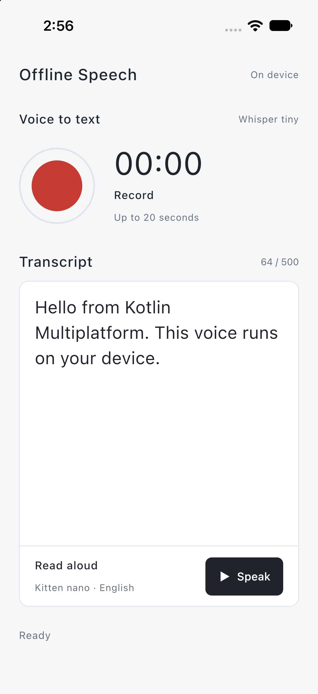
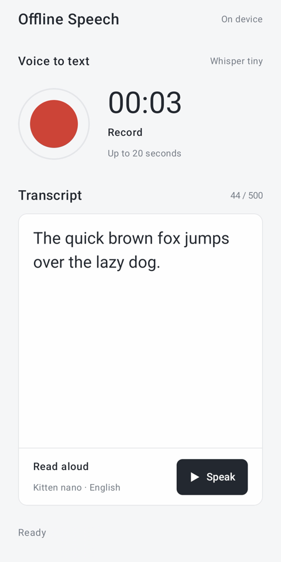

# Demo and captures

Record up to 20 seconds, stop and transcribe, edit the transcript, then Speak. The playback button becomes Stop while generating or playing speech. Cancel discards recording or transcription; synchronous native work may finish before cleanup.

For the code behind these interactions, see [the tutorial's minimal Compose screen](medium-draft.md#7-add-a-small-compose-screen). It connects the same controller actions without the finished app's visual styling.


This GIF records the real Android UI. For a repeatable capture, a test fixture synthesizes a fixed sentence and plays it through the phone's speaker while the normal controller records the microphone. It then presses the real Stop & transcribe and Speak controls. The fixture never inserts a transcript or changes the UI phase directly. GIFs are silent; the physical audio-path evidence is recorded separately.

## Screenshots





Capture environment: Pixel 9 / Android 17 and iPhone 17 arm64 simulator / iOS 27, 2026-11-21. Android media is cropped to the actual application area, excluding the system status bar, developer refresh-rate overlay and gesture bar. No application controls or results are painted over. The iOS screenshot is a complete simulator capture. Screenshots establish appearance; the [verification notes](development.md) distinguish native, acoustic and UI journey checks.

## Selected design direction

- **Product:** short recordings become editable text and local spoken audio.
- **Character:** direct, quiet, tactile.
- **World:** a pocket voice recorder and its transcript.
- **Moments:** the circular record/stop control and the transcript workspace.
- **Signature:** an elapsed-time ring around the recording control, tied to the actual 20-second limit.

The title stays compact. Recording comes first, the transcript receives the main workspace, and playback stays attached to the text. One red recording accent sits within a neutral light palette. Typography uses the native sans-serif family and regular/medium weights. Spacing follows a 4 dp rhythm. The input and controls scroll on short screens or at larger font scales, and status/errors use accessibility live regions. No decorative waveform or invented microphone levels are shown.

This design pass follows [Unslop](https://github.com/heydamir/unslop/blob/main/skills/unslop/SKILL.md), created by Damir Sokolovsky, licensed [CC BY 4.0](https://creativecommons.org/licenses/by/4.0/). The app retains its name, recording → transcript → playback order, and native implementation.

## Reproduce the UI journey

With an unlocked phone and its built-in speaker/microphone available:

```bash
ANDROID_SERIAL=YOUR_SERIAL ./gradlew :androidApp:connectedDebugAndroidTest \
  -Pandroid.testInstrumentationRunnerArguments.demo=true \
  -Pandroid.testInstrumentationRunnerArguments.class=com.debanshu777.speech.android.SpeechUiDemoTest
```

The explicit flag permits sound and microphone access. The test temporarily raises media volume and restores it in `finally`. Capture the app with Android's `screenrecord`, then export the verified UI interval as an animated GIF. The shipped GIF uses 480 × 960 pixels, 8 fps, and a repeating loop. See the [Android host notes](../androidApp/README.md) for the separate acoustic test and exact recognition results.
