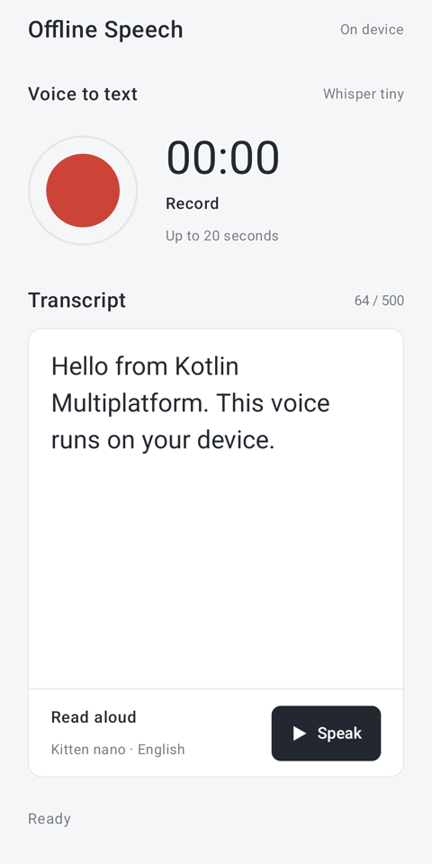

# Run Speech-to-Text and Text-to-Speech Models in Kotlin Multiplatform

Load Whisper and KittenTTS on Android and iOS, then connect them to a small Compose screen.

I wanted a small demo that could record a sentence, turn it into editable text, and read it back on the device. This is the speech integration behind that demo, starting from an existing Kotlin Multiplatform app.

We’ll use Whisper for recognition, KittenTTS for synthesis, and sherpa-onnx to run both. The [complete project](https://github.com/Debanshu777/KmpOfflineSpeech) is available if you want the full adapters and build files. Here, I’ll focus on the model files, the platform calls, and the UI that connects them.



*The actual Android app. For this repeatable recording, the phone’s microphone captures a synthesized sentence played through its speaker.*

## 1. Get the model files

This sample uses **Whisper tiny multilingual INT8 ONNX**, configured for English, and **KittenTTS Nano v0.8 INT8**, an English voice. Keep their supporting files together:

```text
models/
  whisper/
    tiny-encoder.int8.onnx
    tiny-decoder.int8.onnx
    tiny-tokens.txt
  kitten/
    model.int8.onnx
    voices.bin
    tokens.txt
    lexicon-en-us.txt
```

Download Whisper’s encoder, decoder and tokens from this [pinned export](https://huggingface.co/csukuangfj/sherpa-onnx-whisper-tiny/tree/65176e2deb88badc814a94058666cadccc29b61c). Kitten needs the [Nano archive](https://github.com/k2-fsa/sherpa-onnx/releases/download/tts-models/kitten-nano-en-v0_8-int8.tar.bz2) plus the separate [English lexicon](https://github.com/k2-fsa/sherpa-onnx/releases/download/tts-models/lexicon-en-us.txt). The ONNX file alone isn’t enough: Kitten also needs its voice data, tokens and lexicon.

## 2. Prepare the Android and iOS runtimes

Android uses the [sherpa-onnx 2.0.1 AAR](https://github.com/k2-fsa/sherpa-onnx/releases/download/v2.0.1/sherpa-onnx-2.0.1.aar), which includes its native runtime. On iOS, use `SherpaOnnxC.xcframework` and the matching `onnxruntime.xcframework` referenced by the [tagged package manifest](https://github.com/k2-fsa/sherpa-onnx/blob/v2.0.1/Package.swift).

I’ve kept preparation in Gradle. In the companion project, these tasks download and verify the pinned files:

```bash
./gradlew prepareAndroidSpeech
./gradlew prepareIosSpeech
```

For your own app, bring over the [dependency manifest](https://github.com/Debanshu777/KmpOfflineSpeech/blob/main/scripts/dependencies.json), the [Gradle preparation tasks](https://github.com/Debanshu777/KmpOfflineSpeech/tree/main/buildSrc), and their [registration in the root build](https://github.com/Debanshu777/KmpOfflineSpeech/blob/main/build.gradle.kts). They produce the Android AAR and model assets, plus the iOS frameworks and models. The checksums and download handling live there so they don’t take over this tutorial.

In `composeApp/build.gradle.kts`, wire the generated AAR into `androidMain.dependencies`:

```kotlin
val prepareAndroidSpeech = rootProject.tasks
    .named<PrepareAndroidSpeech>("prepareAndroidSpeech")

// Inside androidMain.dependencies:
implementation(files(prepareAndroidSpeech.flatMap { it.runtimeAar })
    .builtBy(prepareAndroidSpeech))
```

Also register the generated assets directory. This makes Android assembly wait for preparation:

```kotlin
extensions.configure<KotlinMultiplatformAndroidComponentsExtension> {
    onVariants { variant ->
        variant.sources.assets?.addGeneratedSourceDirectory(
            prepareAndroidSpeech, PrepareAndroidSpeech::assetsDirectory)
    }
}
```

Use the fully qualified `com.android.build.api.variant.KotlinMultiplatformAndroidComponentsExtension` or import it. On iOS, add the prepared `models` folder to the host app as a folder resource, preserving paths such as `models/whisper/tiny-tokens.txt`. Keep downloaded weights and binaries out of Git.

## 3. Define the shared speech interface

In `commonMain`, represent a mono recording as samples plus its actual sample rate:

```kotlin
data class PcmAudio(val samples: FloatArray, val sampleRate: Int)
interface SpeechPlatform {
    suspend fun requestMicrophonePermission(): Boolean
    suspend fun startRecording()
    suspend fun stopRecording(): PcmAudio
    suspend fun transcribe(audio: PcmAudio): String
    suspend fun synthesize(text: String): PcmAudio
    suspend fun play(audio: PcmAudio)
    suspend fun stop()
    suspend fun close()
}
```

Use float PCM in roughly `-1f..1f`, and reject empty recordings or invalid rates. Keep the captured rate: labelling 48 kHz samples as 16 kHz changes their timing. Pass the original rate to sherpa, which resamples internally.

## 4. Load and run the models on Android

The AAR provides the `com.k2fsa.sherpa.onnx` classes. Copy the packaged assets to `context.filesDir/models` on `Dispatchers.IO`; the configuration below uses filesystem paths. Run model creation and inference on `Dispatchers.Default` so they don’t block the screen.

For Whisper, supply the encoder, decoder and token paths:

```kotlin
val recognizer = OfflineRecognizer(
    config = OfflineRecognizerConfig(
        modelConfig = OfflineModelConfig(
            whisper = OfflineWhisperModelConfig(
                encoder = encoderPath,
                decoder = decoderPath,
                language = "en",
                task = "transcribe",
            ),
            tokens = tokensPath,
            numThreads = 2,
            provider = "cpu",
        ),
    ),
)
```

Then create a stream for the recording and decode it:

```kotlin
try {
    val stream = recognizer.createStream()
    try {
        stream.acceptWaveform(audio.samples, audio.sampleRate)
        recognizer.decode(stream)
        currentCoroutineContext().ensureActive()
        recognizer.getResult(stream).text.trim()
    } finally { stream.release() }
} finally { recognizer.release() }
```

Kitten has a different config, but the same pattern: load, generate, copy the audio value, release.

```kotlin
val tts = OfflineTts(
    config = OfflineTtsConfig(
        model = OfflineTtsModelConfig(
            kitten = OfflineTtsKittenModelConfig(
                model = modelPath,
                voices = voicesPath,
                tokens = tokensPath,
                lexicon = lexiconPath,
            ),
            numThreads = 2,
            provider = "cpu",
        ),
        maxNumSentences = 1,
    ),
)
try {
    val generated = tts.generate(text, sid = 0, speed = 1.0f)
    currentCoroutineContext().ensureActive()
    PcmAudio(generated.samples, generated.sampleRate)
} finally { tts.release() }
```

Use the generated sample rate for playback. This demo creates a session per call, trading repeated loading for straightforward cleanup. The [Android adapter](https://github.com/Debanshu777/KmpOfflineSpeech/blob/main/composeApp/src/androidMain/kotlin/dev/debanshu/speech/AndroidSpeechPlatform.kt) contains the complete functions.

## 5. Call the same models from iOS

On iOS, Kotlin/Native calls sherpa’s C API. The sample’s `speech_audio.h` includes `sherpa-onnx/c-api/c-api.h`; its `speech.def` contains:

```properties
headers = speech_audio.h
package = dev.debanshu.speech.native
```

Choose the device or simulator slice in the shared Gradle build:

```kotlin
val slice = if (target.name == "iosArm64")
    "ios-arm64" else "ios-arm64_x86_64-simulator"
val sherpa = rootProject.file("libs/ios/SherpaOnnxC.xcframework/$slice")
val ort = rootProject.file("libs/ios/onnxruntime.xcframework/$slice")
val interop = target.compilations.getByName("main")
    .cinterops.create("speechNative") {
        defFile("src/iosMain/cinterop/speech.def")
        compilerOpts("-I${file("src/iosMain/cinterop")}",
            "-I$sherpa/SherpaOnnxC.framework/Headers")
    }
```

Link `SherpaOnnxC`, `onnxruntime`, C++, the sample’s audio bridge and its Apple framework dependencies. Make cinterop and framework linking depend on the matching `prepareIosAudioIosArm64` or `prepareIosAudioIosSimulatorArm64` task. The exact [linker options and task wiring](https://github.com/Debanshu777/KmpOfflineSpeech/blob/main/composeApp/build.gradle.kts) are in the shared build file.

Resolve model paths under `NSBundle.mainBundle.resourcePath`. Inside `memScoped`, with `ExperimentalForeignApi` enabled, zero the config before filling it:

```kotlin
val config = alloc<SherpaOnnxOfflineRecognizerConfig>()
memset(config.ptr, 0,
    sizeOf<SherpaOnnxOfflineRecognizerConfig>().convert())
config.feat_config.sample_rate = 16000
config.feat_config.feature_dim = 80
config.model_config.whisper.encoder = encoderPath.cstr.ptr
config.model_config.whisper.decoder = decoderPath.cstr.ptr
config.model_config.whisper.language = "en".cstr.ptr
config.model_config.whisper.task = "transcribe".cstr.ptr
config.model_config.tokens = tokensPath.cstr.ptr
config.model_config.num_threads = 2
config.model_config.provider = "cpu".cstr.ptr
config.decoding_method = "greedy_search".cstr.ptr
val recognizer = SherpaOnnxCreateOfflineRecognizer(config.ptr)
    ?: error("Could not load Whisper")
```

Create a stream with `SherpaOnnxCreateOfflineStream(recognizer)`, then pass the recording and read the result:

```kotlin
audio.samples.usePinned { pinned ->
    SherpaOnnxAcceptWaveformOffline(
        stream, audio.sampleRate,
        pinned.addressOf(0), audio.samples.size,
    )
}
SherpaOnnxDecodeOfflineStream(recognizer, stream)
currentCoroutineContext().ensureActive()
val result = SherpaOnnxGetOfflineStreamResult(stream)
    ?: error("No recognition result")
try {
    result.pointed.text?.toKString()?.trim().orEmpty()
} finally {
    SherpaOnnxDestroyOfflineRecognizerResult(result)
}
```

Wrap the stream and recognizer in `finally` blocks calling `SherpaOnnxDestroyOfflineStream` and `SherpaOnnxDestroyOfflineRecognizer`. Keep C strings within their `memScoped` lifetime and use pinned arrays only for the duration of the call.

For synthesis, zero a `SherpaOnnxOfflineTtsConfig` and fill Kitten’s paths:

```kotlin
config.model.kitten.model = modelPath.cstr.ptr
config.model.kitten.voices = voicesPath.cstr.ptr
config.model.kitten.tokens = tokensPath.cstr.ptr
config.model.kitten.lexicon = lexiconPath.cstr.ptr
config.model.kitten.length_scale = 1f
config.model.num_threads = 2
config.model.provider = "cpu".cstr.ptr
config.max_num_sentences = 1
config.silence_scale = 0.2f
```

Create the TTS handle with `SherpaOnnxCreateOfflineTts`. Zero a `SherpaOnnxGenerationConfig`, set `sid = 0` and `speed = 1f`, then call `SherpaOnnxOfflineTtsGenerateWithConfig`. Copy the returned samples into a Kotlin `FloatArray` and retain their sample rate before destroying the generated audio and TTS handle. The [iOS adapter](https://github.com/Debanshu777/KmpOfflineSpeech/blob/main/composeApp/src/iosMain/kotlin/dev/debanshu/speech/IosSpeechPlatform.kt) shows the full allocation and cleanup sequence.

## 6. Connect the microphone and speaker

Android’s adapter records mono PCM16 with `AudioRecord`, converts shorts using `sample / 32768f`, and plays generated float PCM through `AudioTrack`. Stop and release capture before transcription; finish queued playback before releasing the output track.

On iOS, a small [AVFoundation bridge](https://github.com/Debanshu777/KmpOfflineSpeech/tree/main/composeApp/src/iosMain/cinterop) captures the hardware format, mixes channels to mono, and preserves the rate. Kotlin copies and frees its returned buffer. Playback uses `AVAudioPlayer`.

Android needs `RECORD_AUDIO` in the manifest and a runtime permission request. iOS needs recording permission and this `Info.plist` entry:

```xml
<key>NSMicrophoneUsageDescription</key>
<string>Record a short clip for speech recognition on this device.</string>
```

## 7. Add a small Compose screen

The UI only needs a Record button, an editable transcript, and Speak. A shared [SpeechController](https://github.com/Debanshu777/KmpOfflineSpeech/blob/main/composeApp/src/commonMain/kotlin/dev/debanshu/speech/SpeechController.kt) owns the current operation and exposes a `StateFlow<SpeechUiState>`.

Here’s the wiring using that controller. This is a smaller view of the same interaction shown in the GIF; the finished app adds the circular control and elapsed timer.

```kotlin
@Composable
fun SpeechScreen(platform: SpeechPlatform) {
    val controller = remember(platform) {
        SpeechController(platform,
            CoroutineScope(SupervisorJob() + Dispatchers.Main.immediate))
    }
    DisposableEffect(controller) { onDispose { controller.close() } }
    LifecycleEventEffect(Lifecycle.Event.ON_STOP) { controller.stop() }
    val state by controller.state.collectAsState()
    val idle = state.phase == Phase.Idle
    val recording = state.phase == Phase.Recording
    Column(Modifier.fillMaxSize().safeDrawingPadding()
        .verticalScroll(rememberScrollState()).padding(24.dp),
        verticalArrangement = Arrangement.spacedBy(16.dp)) {
        Button(
            enabled = idle || recording,
            onClick = {
                if (recording) controller.transcribe() else controller.record()
            },
        ) { Text(if (recording) "Stop & transcribe" else "Record") }
        OutlinedTextField(
            value = state.text,
            onValueChange = controller::edit,
            enabled = idle,
            label = { Text("Transcript") },
            modifier = Modifier.fillMaxWidth(),
        )
        Button(onClick = controller::speak,
            enabled = idle && state.text.isNotBlank()) { Text("Speak") }
        if (!idle) {
            TextButton(onClick = controller::stop,
                enabled = state.phase != Phase.Stopping) { Text("Cancel") }
        }
        Text(state.phase.name)
        state.error?.let { Text(it, color = MaterialTheme.colorScheme.error) }
    }
}
```

`record()` asks for permission and starts capture. The next tap calls `transcribe()`, which stops capture, passes its `PcmAudio` to the platform recognizer, and updates `state.text`. `edit()` changes that text. `speak()` passes it to `synthesize()`, then sends the returned audio to `play()`.

The disabled controls prevent overlapping actions. The controller stops recordings at 20 seconds and limits TTS input to 500 characters. It serializes operations and cleanup because cancelling a coroutine doesn’t instantly stop a native decode. `ON_STOP` stops audio when the app leaves the foreground; disposal closes the adapter.

Pass an `AndroidSpeechPlatform` from the Android activity or an `IosSpeechPlatform` from the iOS entry point. Both implement the contract above, so this Compose code stays in `commonMain`. See the [Android host](https://github.com/Debanshu777/KmpOfflineSpeech/blob/main/androidApp/src/main/kotlin/dev/debanshu/speech/android/MainActivity.kt) for permission callback registration and the [iOS entry point](https://github.com/Debanshu777/KmpOfflineSpeech/blob/main/composeApp/src/iosMain/kotlin/dev/debanshu/speech/MainViewController.kt) for its adapter creation.

## Try the complete flow

Record a sentence, transcribe it, change a few words, then tap Speak. Repeat with the network off. Also try denying microphone access and cancelling playback.

The Pixel 9 UI run completed recording → transcription → speech playback and returned to Ready. Earlier acoustic testing misheard “brown” as “round”; the [verification notes](https://github.com/Debanshu777/KmpOfflineSpeech/blob/main/docs/development.md) preserve both results. The iOS host was built and launched in the simulator, with a separate native model roundtrip. Physical iPhone audio remains unverified.

This is a short, foreground-only demo; streaming and audio-route recovery can come later. The [README](https://github.com/Debanshu777/KmpOfflineSpeech#readme) has build requirements and run commands, and [third-party notices](https://github.com/Debanshu777/KmpOfflineSpeech/blob/main/THIRD_PARTY_NOTICES.md) cover the bundled runtimes and models.
